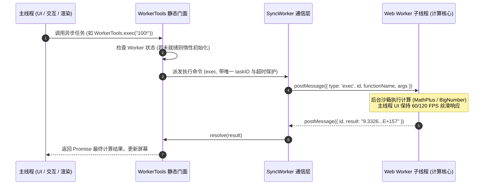
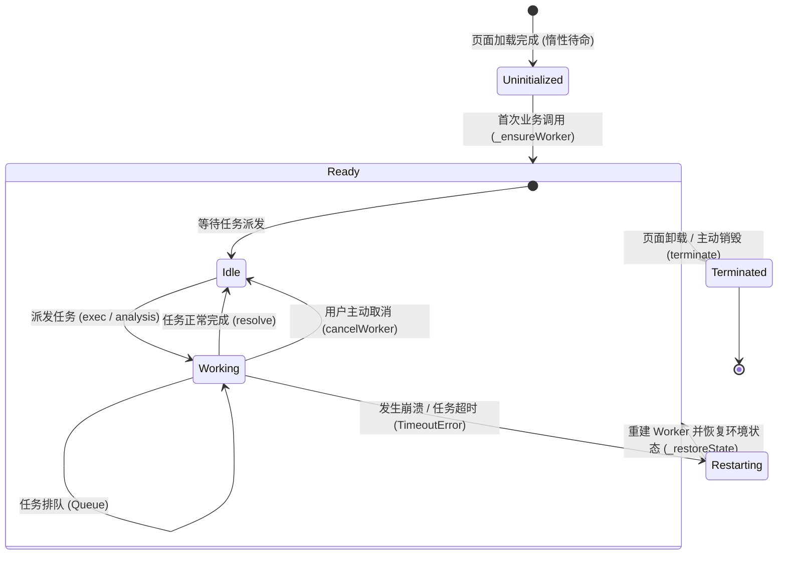

# 异步计算架构与 Worker 系统

任意精度运算与复杂复变函数求值是高 CPU 密集的计算任务。如果直接在浏览器主线程中执行可能耗费数秒的高精度大数计算，会导致网页 UI 卡死、无法响应用户交互（丢帧、滚动停顿）。

Whalgebra 采用基于 Web Worker 的纯客户端异步计算架构，自主研发了 **`SyncWorker`**（底层抽象封装器）与 **`WorkerTools`**（应用层异步门面），实现了**计算与渲染彻底解耦**、**零文件依赖动态打包**以及**故障自动自愈重启**。

---

## 目录

- [1. 整体架构与通信模型](#1-整体架构与通信模型)
- [2. 底层抽象：SyncWorker](#2-底层抽象syncworker)
  - [2.1 无文件依赖的动态 Worker 生成机理](#21-无文件依赖的动态-worker-生成机理)
  - [2.2 跨作用域依赖注入与类序列化](#22-跨作用域依赖注入与类序列化)
  - [2.3 任务队列管理与 Promise 驱动的 RPC 通信](#23-任务队列管理与-promise-驱动的-rpc-通信)
  - [2.4 超时保护与主动取消机制 (Cancellation)](#24-超时保护与主动取消机制-cancellation)
- [3. 应用门面：WorkerTools](#3-应用门面workertools)
  - [3.1 惰性初始化与单例管理](#31-惰性初始化与单例管理)
  - [3.2 崩溃无缝自愈与状态恢复 (Auto-Restart & Sync)](#32-崩溃无缝自愈与状态恢复-auto-restart--sync)
  - [3.3 公开异步 API 详解与调用范例](#33-公开异步-api-详解与调用范例)
    - [3.3.1 表达式异步计算 WorkerTools.exec()](#331-表达式异步计算-workertoolsexec)
    - [3.3.2 高阶分析异步调用](#332-高阶分析异步调用)
    - [3.3.3 全局参数同步修改与查询](#333-全局参数同步修改与查询)
- [4. 生命周期与容灾机制流程图](#4-生命周期与容灾机制流程图)

---

## 1. 整体架构与通信模型



---

## 2. 底层抽象：SyncWorker

`SyncWorker`（位于 `src/js/asynchronous_logic.js`）是一个高度通用的 Web Worker 封装工具类。它将原生浏览器 `Worker` 的事件监听与消息传递机制包装为现代现代化的 **Promise RPC（远程过程调用）**。

### 2.1 无文件依赖的动态 Worker 生成机理

通常 Web Worker 需要引用一个独立的外部脚本文件（如 `worker.js`），这会破坏 Whalgebra “单文件分发（Single HTML File）”的设计原则。

`SyncWorker` 创新性地采用内存代码拼接与 **Blob URL** 方案：
1. 在内存中动态拼接子线程引导代码。
2. 将可调用函数（`callableFunctions`）与外部依赖定义（`dependencies`）序列化后注入代码字符串。
3. 利用 `new Blob([code], { type: 'application/javascript' })` 构建内存虚拟脚本。
4. 调用 `URL.createObjectURL(blob)` 生成可执行的同源 Worker 路径。
5. 初始化原生 Worker 实例，并最终在销毁时调用 `URL.revokeObjectURL(url)` 释放内存。

### 2.2 跨作用域依赖注入与类序列化

由于 Web Worker 运行在独立的操作系统线程和 JavaScript 执行上下文中，无法直接访问主线程的全局变量。`SyncWorker` 内置了高级对象序列化引擎 `_generateWorkerCode()`：
- 能够将主线程中的复杂函数、静态类（如 `BigNumber`、`ComplexNumber`、`MathPlus`、`TokenConfig`、`CalcConfig`）转为其源码表示（`Function.prototype.toString()` / 类声明提取）。
- 支持普通对象、数组、`BigInt`、正则表达式、特殊数值的还原。
- 在 Worker 脚本顶部构建一个自包含的运行时沙箱环境。

### 2.3 任务队列管理与 Promise 驱动的 RPC 通信

主线程每次通过 `exec(functionName, { args, timeout })` 发起调用时：
1. 生成全局递增的唯一任务 ID（`taskId`）。
2. 在内部 `Map`（`this._taskQueue`）中保存该任务的 `resolve`、`reject` 以及计时器句柄。
3. 向 Worker 发送带 ID 的消息包。
4. 当 Worker 回传对应 ID 的成功或错误消息时，定位到该任务并决议 Promise，并清除对应资源。

### 2.4 超时保护与主动取消机制 (Cancellation)

- **超时控制 (`timeout`)**：如果某项任务因计算过于复杂或陷入死循环超过设定阈值（默认 60 秒），自动触发 `TimeoutError` 并中断等待。
- **主动取消 (`cancel()`)**：当用户在计算未完成时点击界面上的“取消”或清空输入时，调用 `cancel()` 会立即向 Worker 发送取消消息，同时拒绝主线程中所有正在排队的任务（抛出 `CancellationError`），避免不必要的算力浪费。

---

## 3. 应用门面：WorkerTools

`WorkerTools` 是直接向项目 UI 与开发者开放的**静态门面类（Facade）**。它全权代理了与数学计算 Worker 的所有交互，并封装了状态管理与故障自愈逻辑。

### 3.1 惰性初始化与单例管理

为了加快网页首次冷启动的速度，页面加载时**不会立即创建 Worker 线程**。
只有在用户首次触发计算、数表生成或修改配置时，`WorkerTools._ensureWorker()` 才会按需构建单例 Worker，并将当前主线程的精度与模式快照同步到子线程。

### 3.2 崩溃无缝自愈与状态恢复 (Auto-Restart & Sync)

当子线程因极端内存消耗被浏览器系统强制杀掉（Out of Memory）或发生超时时：
1. `_dispatch()` 捕获到底层 Worker 终止或超时异常。
2. 自动触发 `WorkerTools.restart()` 重启 Worker。
3. `_restoreState()` 保证将主线程当前的最新配置（计算精度 `globalCalcAccuracy`、输出精度 `outputAccuracy`、复数显示模式 `globalPrintMode`）完整重新注入新启动的 Worker 沙箱中。
4. 保证下一次调用时环境已恢复一致，无须用户手动刷新页面。

### 3.3 公开异步 API 详解与调用范例

#### 3.3.1 表达式异步计算 WorkerTools.exec()

```javascript
WorkerTools.exec(expr, {
    calcAcc,
    outputAcc,
    calcMode = 'calc',
    outputMode = 'output',
    f,
    g
} = {})
```

- **返回值**：`Promise<{ result: string, expr: string }>`
- **调用示例**：
  ```javascript
  // 异步计算 500 的双阶乘与自然对数
  const res = await WorkerTools.exec("ln(500!) + 2^128", {
      calcAcc: 120,
      outputAcc: 30
  });
  console.log("计算结果:", res.result);
  console.log("规范化式:", res.expr);
  ```

#### 3.3.2 高阶分析异步调用

所有在 `core_computational_logic.js` 中定义的耗时工具，均在 `WorkerTools` 中提供了同名的一对一异步调用包装：

```javascript
// 1. 异步多项式分析
const polyAnalysis = await WorkerTools.powerFunctionAnalysis([1, 0, -5, 0, 4]);
console.log("多项式的根:", polyAnalysis.roots);

// 2. 异步统计与回归计算
const stats = await WorkerTools.statisticsCalc([1, 2, 3, 4], [2, 4, 7, 9]);
console.log("最优模型方程:", stats[stats.bestModel].regressionEquation);

// 3. 异步复数根式展开
const roots = await WorkerTools.radicalFunctionAnalysis("-8", 3);
console.log("立方根数值解:", roots.numericalResults);

// 4. 异步函数数表生成
const table = await WorkerTools.valueList("[x]^3", "2^[x]", 0, 0.2, 2);
console.log("采样点与函数值:", table);
```

#### 3.3.3 全局参数同步修改与查询

主线程与子线程的双向配置同步接口（返回 Promise）：

| 方法签名 | 说明 | 返回值 |
| :--- | :--- | :--- |
| **`WorkerTools.setCalcAccuracy(acc)`** | 设置 Worker 的全局计算精度有效位数。 | `Promise<number>` |
| **`WorkerTools.getCalcAccuracy()`** | 获取 Worker 当前计算精度。 | `Promise<number>` |
| **`WorkerTools.setOutputAccuracy(acc)`**| 设置 Worker 当前默认输出精度策略。 | `Promise<number>` |
| **`WorkerTools.getOutputAccuracy()`** | 获取 Worker 当前默认输出精度。 | `Promise<number>` |
| **`WorkerTools.setPrintMode(mode)`** | 设置复数显示模式 (`'algebra'` \| `'polar'`)。 | `Promise<string>` |
| **`WorkerTools.getPrintMode()`** | 获取当前复数显示模式。 | `Promise<string>` |
| **`WorkerTools.cancelWorker()`** | 取消当前正在执行或排队的全部任务。 | `void` |
| **`WorkerTools.restart()`** | 强制重启 Worker 并重新同步环境状态。 | `Promise<void>` |

---

## 4. 生命周期与容灾机制流程图


