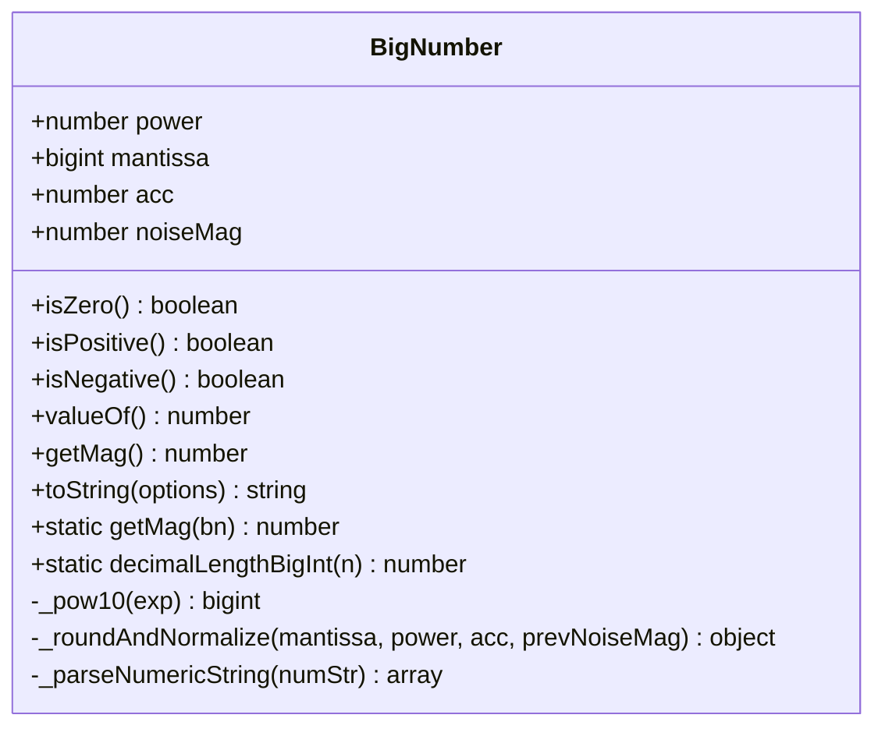
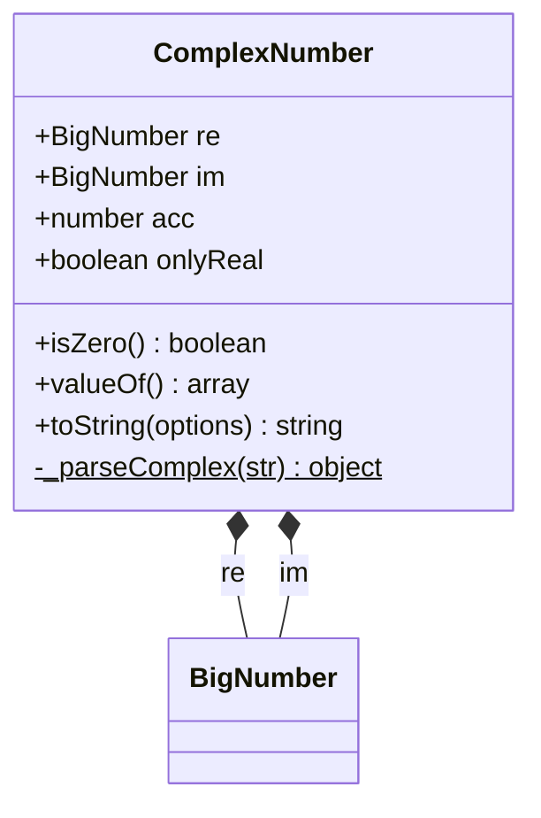
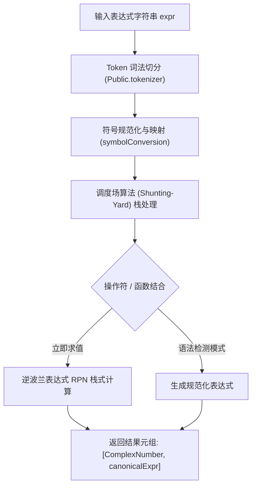

# 数学核心构造器与 MathPlus 计算引擎详解

本文档深入解析 Whalgebra 项目的核心数学引擎。Whalgebra 突破了 JavaScript 标准 IEEE 754 双精度浮点数（约 15~17 位有效数字）的精度瓶颈，基于原生 ES6+ 标准与 `BigInt` 实现了完整的任意精度十进制数运算、复数域代数系统以及工业级的静态函数计算引擎。

> [!NOTE]
> 在部分交流中提及的 **`MathPuls`**，其在项目源码中的官方标准命名为 **`MathPlus`**。为保证接口调用的准确性，本文档统一使用规范标识符 `MathPlus`。

---

## 目录

- [1. 任意精度十进制大数构造器：BigNumber](#1-任意精度十进制大数构造器bignumber)
  - [1.1 内部数据结构与存储原理](#11-内部数据结构与存储原理)
  - [1.2 构造函数与类型支持](#12-构造函数与类型支持)
  - [1.3 实例属性与状态查询](#13-实例属性与状态查询)
  - [1.4 格式化输出与模式切换](#14-格式化输出与模式切换)
  - [1.5 核心静态工具方法](#15-核心静态工具方法)
  - [1.6 BigNumber 代码调用示例](#16-bignumber-代码调用示例)
- [2. 任意精度复数构造器：ComplexNumber](#2-任意精度复数构造器complexnumber)
  - [2.1 数据结构与精度对齐机理](#21-数据结构与精度对齐机理)
  - [2.2 构造函数与多格式输入解析](#22-构造函数与多格式输入解析)
  - [2.3 实例属性与极坐标/代数形式表达](#23-实例属性与极坐标代数形式表达)
  - [2.4 ComplexNumber 代码调用示例](#24-complexnumber-代码调用示例)
- [3. 核心计算器与静态数学库：MathPlus](#3-核心计算器与静态数学库mathplus)
  - [3.1 表达式解析引擎：MathPlus.calc()](#31-表达式解析引擎mathpluscalc)
    - [3.1.1 算法架构与执行流程](#311-算法架构与执行流程)
    - [3.1.2 参数选项与配置说明](#312-参数选项与配置说明)
    - [3.1.3 自定义函数 [f] 与 [g] 的绑定与嵌套](#313-自定义函数-f-与-g-的绑定与嵌套)
    - [3.1.4 语法校验模式 (syntaxCheck)](#314-语法校验模式-syntaxcheck)
  - [3.2 MathPlus 静态数学函数全集](#32-mathplus-静态数学函数全集)
    - [3.2.1 复数特征函数](#321-复数特征函数)
    - [3.2.2 基础代数与幂运算](#322-基础代数与幂运算)
    - [3.2.3 根式运算](#323-根式运算)
    - [3.2.4 指数与对数函数](#324-指数与对数函数)
    - [3.2.5 三角函数与反三角函数](#325-三角函数与反三角函数)
    - [3.2.6 双曲函数与反双曲函数](#326-双曲函数与反双曲函数)
    - [3.2.7 阶乘、伽马函数与特殊运算](#327-阶乘伽马函数与特殊运算)
  - [3.3 精度控制与内部误差消除机制](#33-精度控制与内部误差消除机制)

---

## 1. 任意精度十进制大数构造器：BigNumber

`BigNumber` 是整个项目数值精度的底层基石。它代表一个**不可变（Immutable）**、具备**任意指定有效位数**的十进制数。

### 1.1 内部数据结构与存储原理

传统浮点数由于采用二进制表示，计算 $0.1 + 0.2$ 会产生舍入误差。`BigNumber` 内部使用纯十进制科学表示法：

$$\text{Value} = \text{mantissa} \times 10^{\text{power}}$$

- **`mantissa` (`bigint`)**：带符号的整数尾数。去除了所有尾随零（规范化）。例如，数字 `12.34` 的尾数为 `1234n`，`-0.05` 的尾数为 `-5n`。
- **`power` (`number`)**：十进制指数，必须为 JavaScript 安全整数（`Number.MIN_SAFE_INTEGER` 到 `Number.MAX_SAFE_INTEGER`）。例如 `12.34` 的指数为 `-2`（$1234 \times 10^{-2}$）。
- **`acc` (`number`)**：当前实例的有效位数（Accuracy），控制舍入精度。
- **`noiseMag` (`number`)**：当前数值累积的十进制截断噪声量级上限。字面量或精确输入的默认值为 `-Infinity`；当发生有效位舍入截断或参与四则运算时，系统会自动动态追踪并传播其最大误差量级。



### 1.2 构造函数与类型支持

```javascript
new BigNumber(x, { acc, pow = 0, noiseMag } = {})
```

#### 参数说明：
1. **`x`**：输入数据源，支持以下多种形态：
   - **`string`**：普通十进制（如 `"123.456"`、`"-0.00012"`）或科学记数法（如 `"1.23e-8"`、`"-5.4E+100"`）。允许包含空格和下划线分隔符（如 `"1_000_000"`），最大字符串长度受 `CalcConfig.MAX_INPUT_STRING_LENGTH`（120,459 字符）约束。
   - **`number`**：
     - 若为安全整数（`Number.isSafeInteger(x)`），直接走 `BigInt` 快速路径，零浮点误差转换。
     - 若为非整数浮点数，先自动转为科学记数法字符串（`x.toExponential()`）再进行精准十进制解析。
     - **禁止传入 `NaN` 或 `Infinity`**，否则抛出类型异常。
   - **`bigint`**：保持完全整数精度，根据当前精度进行规范化。
   - **`BigNumber` / 对象**：克隆对象；若提供了新的 `acc`、`pow` 或 `noiseMag`，会在复制的同时重新舍入或平移指数与噪声量级。
   - **`array`**：内部元组 `[power, mantissa]` 或 `[power, mantissa, acc]`，直接构建实例。
2. **`options.acc`** *(可选)*：正整数，结果保留的有效数字位数。若缺省则默认读取全局配置 `CalcConfig.globalCalcAccuracy`（预设值为 220 位）。
3. **`options.pow`** *(可选)*：指数安全偏移量，等价于将该数整体乘以 $10^{\text{pow}}$，常用于科学记数法中间运算。
4. **`options.noiseMag`** *(可选)*：预设的十进制噪声量级上限（默认为 `-Infinity` 或继承自输入）。

### 1.3 实例属性与状态查询

| 属性 / 方法 | 返回类型 | 说明 |
| :--- | :--- | :--- |
| **`power`** | `number` | 十进制指数。当数值为 0 时固定为 0。 |
| **`mantissa`** | `bigint` | 规范化后的整数尾数（末尾不含无效 0）。零值对应 `0n`。 |
| **`acc`** | `number` | 当前实例的有效数字位数。 |
| **`noiseMag`** | `number` | 实例累积的截断噪声上限量级（精确输入为 `-Infinity`）。 |
| **`isZero()`** | `boolean` | 判断是否为绝对零（`mantissa === 0n`）。 |
| **`isPositive()`** | `boolean` | 判断是否严格大于零（`mantissa > 0n`）。 |
| **`isNegative()`** | `boolean` | 判断是否严格小于零（`mantissa < 0n`）。 |
| **`getMag()`** | `number` | 返回当前数值的十进制数量级 $\lfloor \log_{10} |x| \rfloor$；零值返回 `-Infinity`。 |
| **`valueOf()`** | `number` | 将高精度数转为原生 JavaScript `Number` 浮点数。若指数超出安全表示范围会抛错。 |

### 1.4 格式化输出与模式切换

```javascript
bigNum.toString({ acc = this.acc, mode = 'auto' } = {})
```

- **`acc`**：格式化时保留的有效数字位数（必须为正整数）。
- **`mode`**：输出格式模式：
  - `'auto'`（默认）：当整数位与指数之和的绝对值大于 `CalcConfig.TO_STRING_AUTOMATIC_SWITCH_LENGTH`（默认为 10）时，自动采用科学记数法，否则采用标准普通小数。
  - `'normal'`：强制以常规十进制格式输出（如 `"1234.56"`、`"0.0012"`）。
  - `'scientific'`：强制以标准科学记数法输出（如 `"1.23456E+3"`、`"1.2E-3"`）。

### 1.5 核心静态工具方法

- **`BigNumber.getMag(bn)`**：
  计算 `BigNumber` 的十进制数量级（$\lfloor \log_{10} |x| \rfloor$）。空值或绝对零返回 `-Infinity`，非零值返回 `power + decimalLengthBigInt(mantissa) - 1`。
- **`BigNumber.decimalLengthBigInt(n)`**：
  采用二进制快速倍增与查找算法，以 $O(\log_{10} n)$ 的极高效率测定一个 `bigint` 的十进制位数。对于数千位的超大整数，无需执行高耗时的字符串转换（`.toString().length`）。
- **`BigNumber._pow10(exp)`**：
  获取 $10^{\text{exp}}$ 的 `bigint`。内置线性缓存表（上限 512 位），覆盖全部高频运算；超出上限时自动利用快速幂算法计算，平衡性能与内存占用。

### 1.6 BigNumber 代码调用示例

```javascript
// 1. 从多种数据源创建 BigNumber
const bn1 = new BigNumber("3.1415926535897932384626433832795028841971", { acc: 40 });
const bn2 = new BigNumber(1000000);
const bn3 = new BigNumber(9007199254740993n); // 超出 JS Number 范围的大整数
const bn4 = new BigNumber("1.5e-12", { acc: 30, pow: 2 }); // 1.5e-12 * 10^2 = 1.5e-10

// 2. 状态判断
console.log(bn1.isPositive()); // true
console.log(bn1.isZero());     // false
console.log(bn1.power);        // -39
console.log(bn1.mantissa);     // 31415926535897932384626433832795028841971n

// 3. 多种格式化输出
console.log(bn1.toString({ acc: 10, mode: 'normal' }));     // "3.141592654"
console.log(bn1.toString({ acc: 5, mode: 'scientific' })); // "3.1416E+0"
console.log(bn4.toString({ mode: 'normal' }));              // "0.00000000015"
```

---

## 2. 任意精度复数构造器：ComplexNumber

`ComplexNumber` 实现了复数域 $\mathbb{C}$ 的全维度建模。每一个复数实例由两个独立的 `BigNumber`（实部 `re` 和虚部 `im`）组合而成。

### 2.1 数据结构与精度对齐机理

$$\mathbb{C} = \text{re} + \text{im} \cdot i$$

- **`re` (`BigNumber`)**：实部。
- **`im` (`BigNumber`)**：虚部。
- **`onlyReal` (`boolean`)**：标识当前复数是否为纯实数（即 `im.mantissa === 0n`）。在后续的大量算术运算与函数求值中，`onlyReal === true` 会自动激活实数域高速捷径，避开昂贵的复数展开计算。
- **`acc` (`number`)**：实例的全局精度。构造复数时，实部与虚部会自动对齐到二者精度的**较小值**（`Math.min(re.acc, im.acc)`），防止低精度分量在混合运算中伪造高精度假象。



### 2.2 构造函数与多格式输入解析

```javascript
new ComplexNumber(x, { acc, pow = 0 } = {})
```

#### 支持的输入形态：
1. **字符串输入**：内置高效且容错力强的复数词法解析正则 `_COMPLEX_REGEX`，支持多种书写风格：
   - 标准代数形式：`"3 + 4i"`、`"3 - 4i"`、`"3+4[i]"`
   - 虚数单位替代符：支持 `i`、`I`、`j`、`J` 以及系统内部词元 `[i]`（如 `"2.5 + 3.1j"`）
   - 虚数单位与乘号：`"3 + 4*i"`、`"i*4 + 3"`、`"3 + i4"`
   - 隐式单位系数：`"5 + i"`（虚部解析为 1）、`"5 - i"`（虚部解析为 -1）、纯虚数 `"i"`、`"-i"`
   - 纯实数或纯虚数：`"42.5"`、`"-12.8i"`
   - 科学记数法组合：`"-1.23e-4 + 5.67e+8i"`
2. **纯实数输入**：传入 `number`、`bigint` 或 `BigNumber`，虚部自动初始化为 `0`，`onlyReal` 设为 `true`。
3. **二元数组输入**：`[real, imag]`，分别指定实部与虚部。
4. **内部元组数组**：三元数组 `[power, mantissa, acc]`，直接转换为实部为该大数、虚部为 0 的复数。
5. **ComplexNumber 对象克隆**：复制实部与虚部，可附加新的 `acc` 精度。

### 2.3 实例属性与极坐标/代数形式表达

#### 实例方法：
- **`isZero()`**：当且仅当 `re.isZero() && im.isZero()` 时返回 `true`。
- **`valueOf()`**：返回序列化内部嵌套快照：`[[re.power, re.mantissa, re.acc], [im.power, im.mantissa, im.acc]]`。
- **`toString({ acc = this.acc, printMode = CalcConfig.globalPrintMode, mode = 'auto' } = {})`**：
  - **`printMode: 'algebra'`（代数模式）**：
    - 纯实数直接输出实部（如 `"5"`）
    - 纯虚数输出 `"[i]"`、`"-[i]"` 或 `"-3[i]"`
    - 标准复数输出 `"a+b[i]"` 或 `"a-b[i]"`
  - **`printMode: 'polar'`（极坐标模式）**：
    - 计算复数的模 $r = |z|$ 和辐角主值 $\theta = \operatorname{arg}(z) \in (-\pi, \pi]$。
    - 格式化输出为：`"{modulus}[toPolar]{argument}"`（例如 `"2[toPolar]1.5707963"` 代表 $2 \angle \frac{\pi}{2}$）。

### 2.4 ComplexNumber 代码调用示例

```javascript
// 1. 多样化构造
const z1 = new ComplexNumber("3 + 4[i]", { acc: 50 });
const z2 = new ComplexNumber("-1.25e-3 - 2.5e-3i");
const z3 = new ComplexNumber([0, 1]); // 实部 0，虚部 1 -> 纯虚数 i
const z4 = new ComplexNumber(123.45);  // onlyReal 为 true

// 2. 访问内部结构
console.log(z1.onlyReal); // false
console.log(z1.re.toString()); // "3"
console.log(z1.im.toString()); // "4"
console.log(z4.onlyReal); // true

// 3. 代数形式与极坐标形式转换输出
console.log(z1.toString({ printMode: 'algebra' })); // "3+4[i]"
console.log(z1.toString({ printMode: 'polar', acc: 10 })); // "5[toPolar]0.927295218"
```

---

## 3. 核心计算器与静态数学库：MathPlus

`MathPlus` 是整个项目的核心代数运算与表达式计算引擎。它被设计为一个**纯静态类（Static Class）**，不允许被实例化。

```javascript
// 尝试实例化将抛出异常：
// new MathPlus(); // Error: [MathPlus] MathPlus is a static class and should not be instantiated.
```

---

### 3.1 表达式解析引擎：MathPlus.calc()

`MathPlus.calc()` 是 Whalgebra 最强大的公开接口之一，能够将任意数学表达式字符串编译、优化并求解为高精度复数结果。

```javascript
MathPlus.calc(expr, {
    unknown,
    f,
    g,
    mode = 'calc',
    acc = CalcConfig.globalCalcAccuracy
} = {})
```

#### 3.1.1 算法架构与执行流程



1. **词法切分与隐式乘法补全**：
   - 自动识别数字、特殊常量词元（`[pi]`、`[e]`、`[i]`）、自变量（`[x]`）、函数名（`sin`、`cos`、`ln` 等）。
   - 智能插入省略的乘号 `*`：如 `2[x]` $\to$ `2*[x]`，`(a+b)(c+d)` $\to$ `(a+b)*(c+d)`，`3sin([x])` $\to$ `3*sin([x])`。
2. **正负号与减号自动消歧**：
   - 区分一元前缀取负运算符（内部标记为 `N` 即 `_oppositeNumber`）与二元减法运算符 `-`（`minus`）。
3. **调度场算法与优先级控制**：
   - 基于 `TokenConfig.priorityMap` 与右结合性配置，利用操作符栈和数值栈完成中缀表达式向逆波兰式（RPN）的线性时间转换与即时执行。

#### 3.1.2 参数选项与配置说明

| 参数项 | 类型 | 默认值 | 详细说明 |
| :--- | :--- | :--- | :--- |
| **`expr`** | `string` | *(必填)* | 包含合法数学词元的表达式字符串。支持加减乘除、乘方、阶乘、三角函数、超越函数等。 |
| **`unknown`** | `number \| string \| ComplexNumber` | `undefined` | 代入表达式中自变量 `[x]` 的具体数值。若表达式包含 `[x]` 且该参数未提供，会抛出 `x is undefined` 错误。 |
| **`f`** | `string` | `undefined` | 自定义函数 $f(x)$ 的表达式定义体。表达式中可通过 `f(val)` 或 `[f](val)` 调用。 |
| **`g`** | `string` | `undefined` | 自定义函数 $g(x)$ 的表达式定义体。表达式中可通过 `g(val)` 或 `[g](val)` 调用。 |
| **`mode`** | `'calc' \| 'syntaxCheck'` | `'calc'` | 运行模式。`'calc'` 执行真实数学运算并返回结果；`'syntaxCheck'` 仅校验表达式词法语法并补全括号与隐式乘号。 |
| **`acc`** | `number` | `CalcConfig.globalCalcAccuracy` | 本次计算的有效精度位数。默认为 220 位。 |

#### 返回值：
返回一个长度为 2 的二元组：`[result, canonicalExpr]`
- **`result` (`ComplexNumber`)**：计算所得的高精度复数结果。在 `syntaxCheck` 模式下返回占位零。
- **`canonicalExpr` (`string`)**：补全隐式运算符、括号与标准词元后的内部规范化表达式字符串。

#### 3.1.3 自定义函数 [f] 与 [g] 的绑定与嵌套

`MathPlus.calc` 原生支持定义单参数函数 $f(x)$ 与 $g(x)$，且两个函数支持互相调用（解析器具备非法递归环路侦测机制）：

```javascript
// 示例：定义 f(x) = x^2 + 1, g(x) = 2*x + f(x)
// 计算 3 + g(4)
const [res] = MathPlus.calc("3 + g(4)", {
    f: "[x]^2 + 1",     // f(4) = 4^2 + 1 = 17
    g: "2[x] + f([x])"  // g(4) = 2*4 + 17 = 25
});
console.log(res.toString()); // "28" (3 + 25)
```

#### 3.1.4 语法校验模式 (syntaxCheck)

在用户输入阶段，无需执行可能耗时的大数运算，可通过 `mode: 'syntaxCheck'` 快速检查表达式的括号配对、未知符号和语法合法性：

```javascript
try {
    const [, normalized] = MathPlus.calc("sin[x]cos[x] + 2(3+4)", {
        mode: 'syntaxCheck'
    });
    console.log("语法正确，规范化结果:", normalized);
} catch (err) {
    console.error("语法错误:", err.message);
}
```

---

### 3.2 MathPlus 静态数学函数全集

`MathPlus` 提供了 40 多个静态数学函数。所有函数**全面支持传入普通数值、字符串、BigNumber 或 ComplexNumber**，并在内部统一提升为 `ComplexNumber` 处理，返回值恒为 `ComplexNumber`。

#### 3.2.1 复数特征函数

| 函数签名 | 数学含义 | 说明与行为特性 |
| :--- | :--- | :--- |
| **`MathPlus.re(x)`** | $\operatorname{Re}(x)$ | 提取复数的实部，返回实部为该值、虚部为 0 的复数。 |
| **`MathPlus.im(x)`** | $\operatorname{Im}(x)$ | 提取复数的虚部，返回实部为虚部数值、虚部为 0 的复数。 |
| **`MathPlus.arg(x)`** | $\operatorname{Arg}(x)$ | 计算复数的辐角主值，单位为弧度，取值区间 $(-\pi, \pi]$。 |
| **`MathPlus.conj(x)`** | $\overline{x} = a - bi$ | 计算复数的共轭复数。 |
| **`MathPlus.toPolar(r, theta)`** | $r \cdot e^{i\theta}$ | 极坐标转笛卡尔坐标：根据模长 $r$ 和弧度 $\theta$ 返回复数 $r(\cos\theta + i\sin\theta)$。 |

#### 3.2.2 基础代数与幂运算

| 函数签名 | 数学含义 | 说明与行为特性 |
| :--- | :--- | :--- |
| **`MathPlus.plus(a, b)`** | $a + b$ | 复数加法：$(a_r + b_r) + (a_i + b_i)i$。纯实数时走优化捷径。 |
| **`MathPlus.minus(a, b)`** | $a - b$ | 复数减法：$(a_r - b_r) + (a_i - b_i)i$。 |
| **`MathPlus.times(a, b)`** | $a \times b$ | 复数乘法：$(a_r b_r - a_i b_i) + (a_r b_i + a_i b_r)i$。 |
| **`MathPlus.divide(a, b)`** | $a / b$ | 复数除法：采用分母有理化及缩放算法，防止中间平方溢出。若除数为 0 则抛错。 |
| **`MathPlus.mod(a, b)`** | $a \pmod b$ | 取余运算：支持实数与复数取模（基于高斯整数除法舍入）。 |
| **`MathPlus.pow(a, b)`** | $a^b$ | 任意复数幂：对于 $b$ 为正整数走二进制快速幂；对于一般实数或复数幂，基于恒等式 $a^b = \exp(b \cdot \ln a)$ 计算主值。 |
| **`MathPlus.exponential(a, b)`**| $a \times 10^b$ | 十进制科学指数缩放：等价于 `times(a, pow(10, b))`。 |

#### 3.2.3 根式运算

| 函数签名 | 数学含义 | 说明与行为特性 |
| :--- | :--- | :--- |
| **`MathPlus.sqrt(x)`** | $\sqrt{x}$ | 平方根主值。实数 $x \ge 0$ 时先执行十进制指数归约使 $\text{scaled} \in [1, 100)$，再以 $workAcc = acc + 6$ 及相对量级判停进行高精度牛顿迭代；负实数与复数使用复变主分支求值。例如 $\sqrt{-1} = i$。 |
| **`MathPlus.cbrt(x)`** | $\sqrt[3]{x}$ | 立方根主值。实数通过十进制指数归约使 $\text{scaled} \in [1, 1000)$ 后执行相对误差判停的牛顿迭代；负实数保持实数负解（例如 $\sqrt[3]{-8} = -2$）。 |
| **`MathPlus.nroot(a, b)`** | $\sqrt[b]{a}$ | **注意参数顺序**：$a$ 为被开方数，$b$ 为根指数。返回主值 $a^{1/b}$。枚举全部根请使用 `RadicalFunctionTools`。 |

#### 3.2.4 指数与对数函数

| 函数签名 | 数学含义 | 说明与行为特性 |
| :--- | :--- | :--- |
| **`MathPlus.exp(x)`** | $e^x$ | 自然指数函数。复数根据欧拉公式 $e^{u+vi} = e^u(\cos v + i\sin v)$ 计算。 |
| **`MathPlus.ln(x)`** | $\ln(x)$ | 自然对数主值。复数展开为 $\ln|x| + i\operatorname{Arg}(x)$。负实数自然返回包含 $\pi i$ 的复数。$x=0$ 抛错。 |
| **`MathPlus.lg(x)`** | $\log_{10}(x)$ | 常用对数（底数为 10）：$\ln(x) / \ln(10)$。 |
| **`MathPlus.log(a, b)`** | $\log_a(b)$ | **注意参数顺序**：$a$ 为对数底，$b$ 为真数。根据换底公式 $\frac{\ln b}{\ln a}$ 计算，全面支持复数底与复数真数。 |

#### 3.2.5 三角函数与反三角函数

所有三角函数均**默认采用弧度制（Radians）**。若需使用角度制，可配合 `MathPlus.degree(deg)` 转换。

| 函数签名 | 数学含义 | 说明与行为特性 |
| :--- | :--- | :--- |
| **`MathPlus.sin(x)`** | $\sin(x)$ | 正弦函数。实数先进行周期归约至 $[-\pi/2, \pi/2]$；复数按 $\sin(u+vi) = \sin u\cosh v + i\cos u\sinh v$ 计算。 |
| **`MathPlus.cos(x)`** | $\cos(x)$ | 余弦函数。复数展开为 $\cos(u+vi) = \cos u\cosh v - i\sin u\sinh v$。 |
| **`MathPlus.tan(x)`** | $\tan(x)$ | 正切函数：$\sin(x) / \cos(x)$。奇点处抛错。 |
| **`MathPlus.arcsin(x)`** | $\arcsin(x)$ | 反正弦主值：基于复变对数公式 $-i \ln(ix + \sqrt{1 - x^2})$ 计算。定义域扩展至全体复数域。 |
| **`MathPlus.arccos(x)`** | $\arccos(x)$ | 反余弦主值：基于复变对数公式 $-i \ln(x + i\sqrt{1 - x^2})$ 计算。 |
| **`MathPlus.arctan(x)`** | $\arctan(x)$ | 反正切主值：基于公式 $\frac{i}{2} \ln\frac{1 - ix}{1 + ix}$ 计算。 |
| **`MathPlus.degree(x)`** | $x^\circ \to \text{rad}$ | 角度转弧度工具函数：计算 $x \times \frac{\pi}{180}$。 |

#### 3.2.6 双曲函数与反双曲函数

| 函数签名 | 数学含义 | 说明与行为特性 |
| :--- | :--- | :--- |
| **`MathPlus.sh(x)`** | $\sinh(x)$ | 双曲正弦函数：$\frac{e^x - e^{-x}}{2}$。 |
| **`MathPlus.ch(x)`** | $\cosh(x)$ | 双曲余弦函数：$\frac{e^x + e^{-x}}{2}$。 |
| **`MathPlus.th(x)`** | $\tanh(x)$ | 双曲正切函数：$\frac{\sinh(x)}{\cosh(x)}$。 |
| **`MathPlus.arsh(x)`** | $\operatorname{arsinh}(x)$ | 反双曲正弦函数：$\ln(x + \sqrt{x^2 + 1})$。 |
| **`MathPlus.arch(x)`** | $\operatorname{arcosh}(x)$ | 反双曲余弦函数：$\ln(x + \sqrt{x - 1}\sqrt{x + 1})$。 |
| **`MathPlus.arth(x)`** | $\operatorname{artanh}(x)$ | 反双曲正切函数：$\frac{1}{2} \ln\frac{1 + x}{1 - x}$。 |

#### 3.2.7 阶乘、伽马函数与特殊运算

| 函数签名 | 数学含义 | 说明与行为特性 |
| :--- | :--- | :--- |
| **`MathPlus.fact(x)`** | $x!$ | 阶乘函数。对于非负整数采用高效递推累乘；对于负数、小数及复数，自动拓展至伽马函数：$x! = \Gamma(x + 1)$。 |
| **`MathPlus.gamma(x)`** | $\Gamma(x)$ | 伽马函数。采用 Lanczos 高精度逼近算法，预设高达 420 位的 Lanczos 展开系数，全面支持全复数平面求值（负整数极点处抛错）。 |
| **`MathPlus.abs(x)`** | $\|x\|$ | 模长 / 绝对值。实数取绝对值，复数计算模长 $\sqrt{a^2 + b^2}$。 |
| **`MathPlus.sgn(x)`** | $\operatorname{sgn}(x)$ | 符号函数。非零复数返回单位向量 $x / \|x\|$；零返回 0。 |
| **`MathPlus.floor(x)`** | $\lfloor x \rfloor$ | 向下取整。复数分别对其高精度实部与虚部向 $-\infty$ 取整。 |
| **`MathPlus.ceil(x)`** | $\lceil x \rceil$ | 向上取整。复数分别对其高精度实部与虚部向 $+\infty$ 取整。 |

---

### 3.3 精度控制与内部误差消除机制

高精度数值计算中，抵消误差（Catastrophic Cancellation）与累积截断噪声常导致本应为 $0$ 的结果残存形如 $10^{-210}$ 的微小扰动，而传统的固定阈值归零又极易误杀真实的极小物理量（如普朗克常数 $6.626 \times 10^{-34}$ 或量子概率幅 $10^{-40}$）。为此，Whalgebra 构建了全链路的自适应误差消除体系：

1. **截断噪声上界追踪 (`noiseMag`)**：
   - 每一个 `BigNumber` 实例均维护其绝对噪声上界数量级 `noiseMag`。精确数字或字面量的初始值为 $-\infty$。
   - 真正发生有效数字截断舍入时，记录截断位的十进制量级：$\text{power} + \text{shift} - 1$。
   - 四则运算自动传播噪声上界：
     - **加减法**：$\text{noise}_{\text{res}} = \max(\text{noise}_a, \text{noise}_b)$
     - **乘法**：$\text{noise}_{\text{res}} = \max(\text{noise}_a + \text{mag}_b, \text{noise}_b + \text{mag}_a)$
     - **除法**：$\text{noise}_{\text{res}} = \max(\text{noise}_a - \text{mag}_b, \text{noise}_b + \text{mag}_a - 2\text{mag}_b, \text{mag}_{\text{res}} - \text{acc})$
   - 在最终输出格式化阶段（`Public.idealizationToString`），若数值全部落入噪声区间（$\text{mag} \le \text{noiseMag} + 4$），直接安全输出 `"0"`（如链式抵消 $1/3 \times 3 - 1 \equiv 0$、$\sqrt{2}^2 - 2 \equiv 0$），而未经大数相消的真实小量则不受任何影响。

2. **双模式相对零修正 (`Public.zeroCorrect`)**：
   - **无参调用**：仅比对复数的实部与虚部相对尺度。若分量相对另一分量小超过容差 $\text{tol} = \max(\lfloor 0.9 \cdot acc \rfloor, acc - 8)$，则将微弱分量归零，不再设置固定绝对阈值，彻底杜绝误杀纯实数小量。
   - **带参考尺度调用 (`Public.zeroCorrect(x, ...refs)`)**：以输入项的最大量级 $\text{refMag}$ 为基准。在方程求根判别式计算（如二次、三次、四次多项式中判别式项相减）、正切/双曲函数等关键算法处，均将相减两项作为尺度传入，确保大系数或极小系数下的判别式符号与零点判断严谨无误。

3. **超越函数零点与极点规范化**：
   - 周期与区间归约（如 `MathPlus._toLessThanHalfPi`）中，仅在发生周期减法归约时，以原始角度作为尺度参考执行 `Public.zeroCorrect`，既保证 $\sin(k\pi) \equiv 0$、$\cos(\pi/2) \equiv 0$，又完整保留未做归约的超小角度（如 $\sin(10^{-40}) \approx 10^{-40}$）。
   - 正切函数 `MathPlus.tan` 先求正弦再以 $|\sin|$ 为尺度校验余弦零点，精确触发极点未定义异常。

4. **整数修正 (`Public.integerCorrect`)**：
   对于根指数 $n$、阶数等离散整数参量，自动识别与消除无限循环小数尾数，保证如 `2.99999999999999999999` 准确还原为整数 `3`。

5. **根式牛顿迭代十进制归约与相对判停**：
   - **十进制指数归约**：设正实数 $|x| = m \times 10^p$，科学指数 $\text{sciExp} = p + \text{len}(m) - 1$。对 $n$ 次方根（平方根 $n=2$、立方根 $n=3$），令 $k = \lfloor \text{sciExp} / n \rfloor, r = \text{sciExp} - n \cdot k$，将输入改写为 $\text{scaled} = m \times 10^{r - \text{len}(m) + 1}$。归约后 $\text{scaled} \in [1, 10^n)$，原生浮点初值恒安全有效（彻底消除 $10^{400}$ 或 $10^{-400}$ 溢出/下溢），根的量级固定在 $[1, 10)$，最后一次性乘回 $10^k$。
   - **保护位与相对判停**：内部使用 $workAcc = acc + 6$ 计算，常数与被开方数均显式携带保护精度。判停条件基于残差十进制量级 $\text{diffMag} = \text{getMag}(\text{difference}) \le -(acc + 2)$，直接等价于相对误差判定，并结合连续两轮残差不缩小保护，彻底杜绝大数量级回退、小数提前欠收敛与末位 1 ULP 震荡。
   - **解耦全局精度的迭代上限**：迭代上限由 $\max(20, \lceil\log_2(workAcc)\rceil + 10)$ 动态确定，充分发挥二次收敛特性。

---

## 4. 综合调用实战示例

```javascript
// ==========================================
// 场景一：直接调用静态函数完成高精度微积分/几何计算
// ==========================================
const pi = new ComplexNumber(CalcConfig.constants.pi); // 读取内置超高精度圆周率
const radius = new BigNumber("12.345678901234567890123456789");

// 计算圆面积 S = π * r^2
const rSquared = MathPlus.pow(radius, 2);
const area = MathPlus.times(pi, rSquared);
console.log("圆面积 (前50位):", area.toString({ acc: 50 }));

// ==========================================
// 场景二：复数域欧拉公式检验: e^(i*pi) + 1 == 0
// ==========================================
const i = new ComplexNumber([0, 1]); // 虚数单位 i
const iPi = MathPlus.times(i, pi);
const eToIPi = MathPlus.exp(iPi);
const eulerResult = MathPlus.plus(eToIPi, 1);
console.log("欧拉恒等式检验:", eulerResult.toString()); // 输出为 "0"

// ==========================================
// 场景三：解析复杂字符串表达式
// ==========================================
const expr = "sqrt(1 - sin([pi]/6)^2) + ln([e]^3) * (2 + 3[i])!";
const [calcVal, normalized] = MathPlus.calc(expr, { acc: 60 });
console.log("规范化表达式:", normalized);
console.log("计算最终结果:", calcVal.toString({ printMode: 'algebra' }));
```
