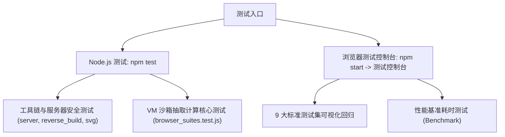

# 工程工具链、本地服务与测试体系

Whalgebra 坚持“**零第三方开发依赖**（Zero Dev Dependencies）”与“**单文件轻量分发**”的工程哲学。项目的所有辅助工具、本地静态服务器和自动化测试用例，均直接基于 **Node.js 原生 API**（`node:http`、`node:fs`、`node:test`、`node:vm`）构建。

---

## 目录

- [1. 单文件与工程化源码的演进：逆向构建系统](#1-单文件与工程化源码的演进逆向构建系统)
  - [1.1 设计背景：分发便利性与源码可维护性的统一](#11-设计背景分发便利性与源码可维护性的统一)
  - [1.2 reverse_build.js 的工作原理与 CLI 参数](#12-reverse_buildjs-的工作原理与-cli-参数)
  - [1.3 源码拆分结果映射表](#13-源码拆分结果映射表)
- [2. 资源压缩与字体生成：SVG Compressor](#2-资源压缩与字体生成svg-compressor)
  - [2.1 SVG 矢量优化与转曲检测](#21-svg-矢量优化与转曲检测)
  - [2.2 自动生成 Base64 内嵌 CSS](#22-自动生成-base64-内嵌-css)
- [3. 本地轻量开发服务器：run_server.js](#3-本地轻量开发服务器run_serverjs)
  - [3.1 启动方式与参数选项](#31-启动方式与参数选项)
  - [3.2 安全限制与同源受限 Web API](#32-安全限制与同源受限-web-api)
- [4. 全方位测试体系与质量保障](#4-全方位测试体系与质量保障)
  - [4.1 Node.js 原生回归测试 (npm test)](#41-nodejs-原生回归测试-npm-test)
  - [4.2 VM 沙箱端到端运行真实计算核心](#42-vm-沙箱端到端运行真实计算核心)
  - [4.3 浏览器端交互式测试控制台与九大测试集](#43-浏览器端交互式测试控制台与九大测试集)
  - [4.4 新增与维护测试用例 (test/cases) 规范](#44-新增与维护测试用例-testcases-规范)

---

## 1. 单文件与工程化源码的演进：逆向构建系统

### 1.1 设计背景：分发便利性与源码可维护性的统一

在实际发布时，一个包含所有 HTML、CSS 与 JS 的单一 `.html` 文件（`dist/Whalgebra.html`）是体验最好的分发形态——用户可双击离线运行，无需安装任何服务器。

但在源码开发阶段，将数万行代码混写在一个 HTML 文件中会导致协作困难、Git Diff 混乱且无法进行精细的代码检查。为此，项目开发了**逆向构建工具（Reverse Build）**，能自动将单文件发行版精确、无损地逆向拆分为模块化的现代前端工程源码。

### 1.2 reverse_build.js 的工作原理与 CLI 参数

```powershell
npm run reverse-build -- --force
```

等价于运行：
```powershell
node tools/cli/reverse_build.js dist/Whalgebra.html --out src --force
```

#### 工作流：
1. **语义化标签定位**：解析输入 HTML 中的 `<style>` 与 `<script>` 标签。
2. **智能去缩进 (Smart Dedent)**：去除内联代码原有的多层 HTML 缩进，使拆出后的独立 CSS 和 JS 文件从第 0 列开始，符合标准代码工程规范。
3. **改写引用**：在目标目录的 `index.html` 中将原本的内联块自动替换为外部 `<link rel="stylesheet">` 与 `<script defer src="...">` 引入，并自动生成 `.nojekyll` 以便部署到 GitHub Pages。

### 1.3 源码拆分结果映射表

| 拆分出的源码路径 | 内容职责 |
| :--- | :--- |
| **`src/index.html`** | 模块化页面骨架入口。 |
| **`src/css/style.css`** | 计算器主要页面布局、键盘网格与视口响应式样式。 |
| **`src/css/fonts_and_images.css`**| 拆出的全部内联 SVG 字体与图标 Base64 样式。 |
| **`src/js/shared_code_and_configuration.js`** | `TokenConfig`、`CalcConfig` 与 `Public` 配置与通用工具。 |
| **`src/js/core_computational_logic.js`** | `BigNumber`、`ComplexNumber`、`MathPlus` 及全部高阶数学分析工具。 |
| **`src/js/asynchronous_logic.js`** | `SyncWorker` 与 `WorkerTools` 异步多线程架构。 |
| **`src/js/ui_styling_control.js`** | `VirtualScroll`、`InputManager`、`PrintManager` 等交互逻辑。 |
| **`src/js/init.js`** | 全局点击分发与生命周期初始化脚本。 |

---

## 2. 资源压缩与字体生成：SVG Compressor

为了在任何高分屏设备上保持绝对清晰，Whalgebra 的所有数学符号与运算符图标均采用 SVG。

```powershell
npm run compress-svg
```

### 2.1 SVG 矢量优化与转曲检测

工具位于 `tools/cli/svg_compressor.js`：
- 对指定输入目录中的 `.svg` 矢量图标进行无损优化与冗余元数据剔除（去除多余标签、清理隐藏路径）。
- **文本转曲检测**：如果输入的 SVG 包含 `<text>`、`<tspan>` 等文本标签，工具会给出警告，提醒开发者在矢量软件中将其先转换为闭合路径（Path），以防在缺少相应字体的用户设备上发生渲染变形。

### 2.2 自动生成 Base64 内嵌 CSS

压缩完成后，工具自动将优化后的 SVG 转换为 Data URI Base64 字符串，并格式化为 CSS 类：

```css
.svg-operator-sin {
    content: url("data:image/svg+xml;base64,...");
    height: 5dvmin;
}
```

---

## 3. 本地轻量开发服务器：run_server.js

Whalgebra 自带基于 Node.js 原生 `http` 模块编写的静态服务器（`tools/server/run_server.js`）。

### 3.1 启动方式与参数选项

```powershell
# 基础启动（从 8000 端口寻找可用端口）
npm start

# 常用自定义启动参数
node tools/server/run_server.js --dir . --port 8080 --open
```

| 参数选项 | 说明 |
| :--- | :--- |
| **`--dir <PATH>`** | 指定服务托管的根目录，默认为当前项目根目录。 |
| **`--port <PORT>`** | 指定服务器起始监听端口，若被占用会自动尝试下一个端口。 |
| **`--local`** | *(默认)* 仅监听本机回环地址 `127.0.0.1`。 |
| **`--lan`** | 监听 `0.0.0.0`，允许同局域网内的手机或平板设备访问预览。 |
| **`--open`** | 启动成功后自动调起默认浏览器打开入口工作台。 |

### 3.2 安全限制与同源受限 Web API

为了杜绝任意文件覆写风险，服务器实现了极严格的防御策略：
- **安全响应头**：强制输出 `Cache-Control: no-cache, no-store, must-revalidate`、`X-Content-Type-Options: nosniff` 和 `Referrer-Policy: same-origin`。
- **目录遍历防护**：访问无 `index.html` 的目录时直接返回 `403 Forbidden`，不开放目录列出。
- **Web 工具受限 API**：
  - `POST /api/tools/reverse-build`
  - `POST /api/tools/svg-compressor`
  - 仅接受来自同源（Same-Origin）的 `application/json` 请求。
  - 请求路径被限制必须位于当前项目内，且写出目录限制在 `src` 或 `tmp` 下，禁止向磁盘根目录或父级目录写文件。

---

## 4. 全方位测试体系与质量保障

Whalgebra 构建了覆盖**工具链、服务器安全、计算核心算法与性能基准**的立体测试体系。



### 4.1 Node.js 原生回归测试 (npm test)

利用 Node 20+ 原生具备的 `node:test` 测试运行器，在终端秒级执行全量测试：

```powershell
npm test
```

### 4.2 VM 沙箱端到端运行真实计算核心

`test/node/browser_suites.test.js` 采用了一个极具创意的设计：
它直接读取单文件 `dist/Whalgebra.html` 中的计算核心代码，在 Node.js 的 `node:vm` 隔离沙箱中还原浏览器的全局环境，然后直接执行浏览器端测试逻辑 `test/browser/test_logic.js` 的所有 8 个计算测试集！
这确保了命令行测试与真实浏览器运行的逻辑**100% 同源且同质**。

### 4.3 浏览器端交互式测试控制台与九大测试集

运行 `npm start` 打开网页版“测试控制台”（`test/web/index.html`），可实时查看每条用例的输入、期望值、实际值以及耗时。

测试集清单维护于 `test/cases/test_suites.json`：

| ID | 测试集名称 | 对应 Case 文件 | 覆盖重点 |
| :---: | :--- | :--- | :--- |
| **1** | 表达式测试 - 综合分支 | `test_mathplus_calc_complex_cases.json` | 极复杂表达式、多重括号、科学记数法混合运算。 |
| **2** | 表达式测试 - 正确分支 | `test_mathplus_calc_normal_cases.json` | 常见代数运算、标准优先级、隐式乘法、极坐标格式化。 |
| **3** | 表达式测试 - 错误分支 | `test_mathplus_calc_error_cases.json` | 语法报错、除以零、非法字符、未闭合括号捕获。 |
| **4** | MathPlus 函数测试 | `test_mathplus_functions.json` | 40+ 静态数学函数（三角、双曲、伽马、超越函数）精度分支。 |
| **5** | 幂函数分析测试 | `test_power_function.json` | 0-4 次实系数多项式图像、极值、单调区间与根。 |
| **6** | 根式函数测试 | `test_radical_function.json` | 复数高阶根式、棣莫弗公式、数值根展开。 |
| **7** | 函数值列表测试 | `test_func_value_list.json` | 自定义函数步长采样与边界截断。 |
| **8** | 统计计算测试 | `test_statistics.json` | 双变量描述性统计量与 7 种回归模型拟合。 |
| **9** | 性能基准测试 | `null` (内部固定执行) | 对 `pow`、`fact` 等核心高耗时函数循环 111 次统计毫秒级平均耗时。 |

### 4.4 新增与维护测试用例 (test/cases) 规范

新增测试用例时，只需向 `test/cases/` 对应的 JSON 文件追加数据，格式如下：

```json
{
  "description": ["[新功能测试] 描述性文字"],
  "coeffs": [
    "sin([pi]/6)",
    220,
    0.9,
    "calc",
    "output"
  ],
  "expected": {
    "result": "0.5",
    "expr": "sin([pi]/6)"
  }
}
```

保存后运行 `npm test`，即可自动完成全量测试回归验证。
