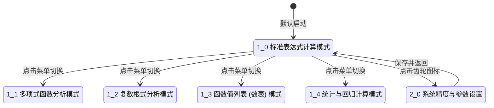

# UI 交互、虚拟滚动与渲染层

Whalgebra 的用户界面完全基于**原生 HTML5、CSS3 与 Vanilla JavaScript** 构建，不依赖任何第三方前端框架（如 React、Vue 或 jQuery）。所有字形与图标均采用内联或 Base64 编码的 **SVG 矢量资源**，确保在不同分辨率的桌面端与移动端屏幕上均能呈现像素级的清晰度。

---

## 目录

- [1. 界面模块划分与计算模式流转](#1-界面模块划分与计算模式流转)
  - [1.1 六大功能模式与页面视图](#11-六大功能模式与页面视图)
  - [1.2 PageConfig 布局与响应式断点](#12-pageconfig-布局与响应式断点)
- [2. 高性能虚拟滚动引擎：VirtualScroll](#2-高性能虚拟滚动引擎virtualscroll)
  - [2.1 设计初衷与性能挑战](#21-设计初衷与性能挑战)
  - [2.2 核心内部组件：状态机、高度映射与节点池](#22-核心内部组件状态机高度映射与节点池)
  - [2.3 容器尺寸自适应与 ResizeObserver 监听](#23-容器尺寸自适应与-resizeobserver-监听)
- [3. 输入与键盘交互系统：InputManager](#3-输入与键盘交互系统inputmanager)
  - [3.1 物理键盘快捷键映射](#31-物理键盘快捷键映射)
  - [3.2 虚拟光标定位与文本流管理](#32-虚拟光标定位与文本流管理)
  - [3.3 括号智能自动配对与合法性感知](#33-括号智能自动配对与合法性感知)
- [4. 输出与屏幕渲染管理：PrintManager](#4-输出与屏幕渲染管理printmanager)
  - [4.1 多格式结果展示与极坐标/代数切换](#41-多格式结果展示与极坐标代数切换)
  - [4.2 语法错误精确定位与视觉高亮](#42-语法错误精确定位与视觉高亮)
  - [4.3 历史记录快照与剪贴板集成](#43-历史记录快照与剪贴板集成)
- [5. 页面状态与事件分发：PageControlTools](#5-页面状态与事件分发pagecontroltools)

---

## 1. 界面模块划分与计算模式流转

页面的主控制器 `PageControlTools` 与界面配置单例 `PageConfig` 协同管理了整个 UI 的状态机流转。

### 1.1 六大功能模式与页面视图

通过顶部导航与功能菜单，用户可在以下 6 种计算模式间无缝切换：

- **`1_0` 标准代数计算器**：全功能虚拟键盘，支持复杂表达式、历史回显与复制。
- **`1_1` 多项式分析**：输入降幂系数，一键展示根、极值点、拐点及单调区间卡片。
- **`1_2` 复数根式展开**：输入复数与根指数，展示带 $k$ 通式与数值根列表。
- **`1_3` 函数数表**：设定步长与区间，生成包含自变量、$f(x)$、$g(x)$ 的滚动表格。
- **`1_4` 统计与回归**：输入成对样本，自动输出描述性统计量与 7 种回归方程对比。
- **`2_0` 设置中心**：实时调节计算精度、输出精度与复数表示模式。

### 1.2 PageConfig 布局与响应式断点

`PageConfig` 集中管理所有视口比例（基于 `dvmin` 响应式视口单位）、键盘布局行列比以及字体缩放规则。支持根据屏幕宽高比自动切换**竖屏移动端紧凑布局**与**横屏桌面端多列扩展布局**。

---

## 2. 高性能虚拟滚动引擎：VirtualScroll

在生成上千行的“函数值列表”或呈现海量“历史计算记录”时，若直接创建成千上万个原生 DOM 节点，会导致浏览器重排重绘卡顿并耗费大量内存。Whalgebra 自研了轻量级、高吞吐的 **`VirtualScroll`** 虚拟滚动引擎。

### 2.1 设计初衷与性能挑战

- **固定内存开销**：无论数表有 100 行还是 100,000 行，DOM 树中常驻的渲染节点数始终维持在当前可见区域所需的微小常数（约 15~30 个）。
- **动态高度自适应**：允许每行内容包含不同长度的数学公式与换行，动态测量并缓存每项真实高度。

### 2.2 核心内部组件：状态机、高度映射与节点池

1. **状态机 (`_StateMachine`)**：
   驱动滚动周期的状态流转（`IDLE`、`SCROLLING`、`RESIZING`），在高速滚动中利用 `requestAnimationFrame` 合并帧渲染，消除滚动抖动。
2. **动态高度映射器 (`_HeightMapper`)**：
   采用**前缀和数组（Prefix Sum）**与**二分查找法（Binary Search）**。给定当前的垂直滚动偏移量 `scrollTop`，能在 $O(\log n)$ 时间内精确定位第一个可见元素的索引。
3. **节点池 (`_NodePool`)**：
   维护空闲与在用 DOM 节点池。滑出屏幕上方的节点被无损回收，移动到屏幕下方填充新的数据项，彻底消除由于频繁 `createElement` 和 `remove` 引起的垃圾回收（GC）卡顿。

### 2.3 容器尺寸自适应与 ResizeObserver 监听

引擎优先注册浏览器的 `ResizeObserver` 监听容器尺寸波动；在不支持的高龄浏览器环境中，优雅降级监听 `window.resize` 并比对 `clientWidth / clientHeight`，在窗口大小改变时自动重绘可见区间。

---

## 3. 输入与键盘交互系统：InputManager

`InputManager` 统一调度屏幕上的虚拟键帽点击与物理键盘的输入事件。

### 3.1 物理键盘快捷键映射

为了提升专业用户的输入效率，系统内置了直观的键盘映射机制：

| 键盘按键 | 对应数学功能 | 行为描述 |
| :--- | :--- | :--- |
| **`Enter`** | 计算 / 执行 | 触发当前模式的求解或表达式计算。 |
| **`Backspace`** | 退格删除 | 智能删除光标左侧的一个词元（完整删除如 `sin`、`[pi]`，而非单个字符）。 |
| **`Delete`** | 向后删除 | 智能删除光标右侧的一个词元。 |
| **`Alt + E`** | 输入常数 $e$ | 快捷插入内部词元 `[e]`。 |
| **`Alt + I`** | 输入虚数 $i$ | 快捷插入内部词元 `[i]`。 |
| **`Alt + X`** | 输入自变量 $x$ | 快捷插入自变量词元 `[x]`。 |
| **方向键 `←` / `→`** | 光标移动 | 按词元跳跃移动虚拟光标，长按支持连续移动。 |
| **`Home` / `End`** | 首尾跳转 | 光标直接跳转至表达式起始或末尾。 |

### 3.2 虚拟光标定位与文本流管理

主输入框内部包含一个闪烁的虚拟光标元素（`[cursor]` 词元）：
- 用户点击输入框任意位置时，系统计算点击坐标距离哪个词元最近，并将光标移动至相应缝隙。
- 输入文本时，新符号直接插入在光标所在位置，且输入框自动向右横向平滑滚动，保持光标始终位于可视区。

### 3.3 括号智能自动配对与合法性感知

- **成对插入与高亮匹配**：当光标位于开括号 `(` 旁时，自动高亮其对应的闭括号 `)`，便于识别复杂嵌套逻辑。
- **自动补全**：若用户未输入末尾的闭括号直接点击计算，词法规范化流程会自动在表达式末端补齐缺失的括号。

---

## 4. 输出与屏幕渲染管理：PrintManager

`PrintManager` 全面负责主屏幕的输出排版与历史记录回溯。

### 4.1 多格式结果展示与极坐标/代数切换

- 计算完成后，屏幕以两行呈现：上方为规范化后的数学表达式，下方为加粗的高精度计算结果。
- 对于复数计算结果，支持点击一键切换代数形式（$a+bi$）与极坐标形式（$r\angle\theta$）。

### 4.2 语法错误精确定位与视觉高亮

当用户输入了不合规的表达式（如括号不匹配、运算符连续重叠、非法符号）时：
- `PrintManager` 捕获解析器抛出的结构化异常。
- 屏幕以鲜明的警示色展示错误原因，并在错误出现的输入片段下方进行波浪线定位高亮。

### 4.3 历史记录快照与剪贴板集成

- 每次成功的计算均会打包为一个快照，记录输入表达式、最终数值结果、时间戳以及当时的计算精度。
- 用户点击历史卡片即可将历史表达式重新填充回当前输入框，或将计算数值一键复制到操作系统剪贴板。

---

## 5. 页面状态与事件分发：PageControlTools

`PageControlTools`（位于 `src/js/ui_styling_control.js`）是整个界面的粘合剂：
- **统一事件代理**：在全局根节点（`document`）统一监听 `click` 事件，依据目标元素的 `id` 与 `class` 分发页面控制，杜绝为每个按钮单独绑定事件监听器导致的内存泄漏。
- **操作符说明弹窗 (`explain`)**：长按或悬停在任意运算符上时，自动呼出包含该运算符中文名称、定义域、用法说明及示例公式的 SVG 说明卡片。
